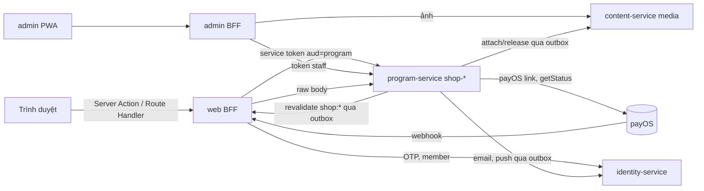
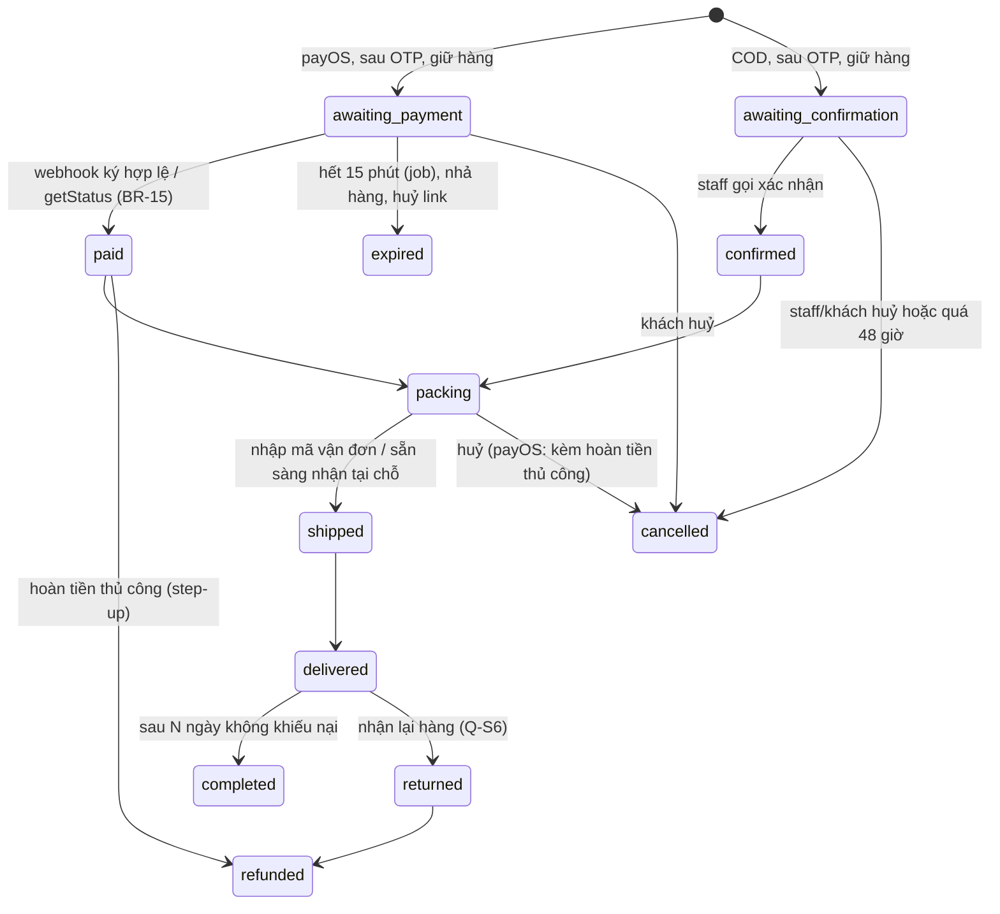

# 08: Kế hoạch phân hệ Cửa hàng (Shop)

> **Trạng thái: BẢN ĐỀ XUẤT, CHỜ DUYỆT (17/11/2026).** Chưa có dòng code nào được viết. Tài liệu này chưa thay đổi `docs/01`–`04`; các thay đổi ở đó (BR-10, ADR mới, permission, collection) chỉ làm sau khi các câu hỏi ở §12 được trả lời.
>
> Số `05` đã dùng cho Phân hệ Chương trình, nên kế hoạch Cửa hàng lấy số `08`.
>
> Nguồn đã đọc: `CLAUDE.md`, `docs/01` (BR-01, BR-09, BR-10, UC-18/25), `docs/02` §3, §8.2, §9.3, §14, `docs/03`, `docs/04`, `docs/05`, ADR-0014/0015/0020/0025/0026/0027, `docs_temp/LAVIECO Tai lieu dinh vi v1_3.md` §1, §3, §5, mã nguồn `program-service` (`orders`, `payments`, `vouchers`, `ticketing`, `registrations`, `surveys`, `campaigns`, `staff-alerts`), `content-service` (`media`, `catalog`), `apps/web` (`checkout`, `account`, `collection`), `apps/admin` (`events`, `shop`, `pwa`), `packages/ui`, `packages/shared`, mẫu Stitch ở `docs/design/shop_lavieco/`.

---

## Quyết định đã chốt (17/11/2026)

| Mã | Quyết định |
|---|---|
| Q-S1 | Giá cố định, sửa BR-10 (LAVIECO đã qua giai đoạn bán hàng). |
| Q-S2 | Pháp lý bổ sung sau khi xong chức năng; cờ `SHOP_ENABLED` giữ Cửa hàng tắt trên production tới lúc đó. |
| Q-S3 | **Phí giao mặc định 20.000đ**, admin sửa được ở cài đặt cửa hàng; mã ưu đãi giảm được cả phí giao (loại ưu đãi "miễn/giảm phí giao"). |
| Q-S4 | **Có COD**, chỉ cho đơn **≤ 200.000đ**; đơn trên 200.000đ phải thanh toán trước qua payOS. Mức này admin sửa được. |
| Q-S6 | **Đổi trả trong 14 ngày** kể từ khi nhận nếu hàng lỗi; **khách chịu phí gửi trả**. |
| Q-S7 | Đối tác theo mặc định: tỉ lệ hoa hồng theo thương hiệu, chụp lên dòng đơn; LAVIECO giữ kho và giao. |
| Q-S8 | Đường dẫn **`/bo-suu-tap`** cho trang bán (danh sách và chi tiết sản phẩm). |
| Q-S16 | Được dùng `@dnd-kit` (kéo thả ảnh) và `fflate` (giải nén zip trong trình duyệt). |
| Ảnh khi import cập nhật | **Không thay toàn bộ.** Ảnh mới được **thêm** vào sau ảnh hiện có. Bước xem trước hiện ảnh hiện có + ảnh mới dạng thẻ có nút **×** để bỏ từng ảnh, và nút **"Bỏ toàn bộ ảnh cũ"**. Ảnh bị bỏ được giải phóng khi xác nhận. |
| Còn lại | Theo mặc định ở §12. |

## 0. Tóm tắt một trang

- **Đặt Cửa hàng trong `program-service`** (nhóm module `shop-*` mới), không tạo service thứ 7. Lý do chính: giữ hàng + mã giảm giá + đơn phải nằm trong **một giao dịch của một service** (luật cứng §5.6), và payOS, sổ mã giảm giá, OTP chứng thực email, email, khảo sát, chiến dịch, cảnh báo đẩy cho staff, `exceljs` đều đã ở đó. Cần **ADR-0028** sửa lộ trình `order-service` ở `docs/02` §14.2. Phương án khác ở §3.1.
- **BR-10 sẽ sửa (đã chốt 17/11/2026):** LAVIECO đã qua giai đoạn bán hàng (tương đương GĐ2), sản phẩm trong Cửa hàng có **giá cố định**. Sửa `docs/01` ở S0.
- **BR-01 vẫn là luật trên hết:** mỗi trang sản phẩm có story card + liên kết về Cẩm nang; tên gọi, bố cục, câu chữ không biến LAVIECO thành "cửa hàng đồ thủ công".
- **Mẫu Stitch chỉ có 8 màn** (giỏ hàng ×2, thanh toán ×2, admin sản phẩm, admin đơn hàng, admin tổng quan, admin mobile). Các màn danh sách, chi tiết sản phẩm, tra cứu đơn, tài khoản, đánh giá, form sản phẩm, import **không có trong thư mục**, sẽ dựng theo hệ thống hiện có (§5).
- **Mẫu có nhiều số liệu và cam kết bịa** ("giải cứu 210g", "giảm 320kg CO2e", "Quỹ Sinh kế sông Hậu", "đổi trả 7 ngày", "freeship toàn quốc", "ven biển", "NFC"...). Không đưa vào: vi phạm BR-09 và định vị v1.3.
- **Không có hệ thống toast** trong repo, **không có thư viện kéo thả**, **không có thư viện giải nén**: cần thêm `Toast`/`Skeleton` tự viết ở `@lavieco/ui` và xin duyệt 1–2 phụ thuộc (§12, Q-S16).
- Chia **8 giai đoạn** S0–S7 (§11), mỗi giai đoạn chạy và kiểm thử được, dừng chờ duyệt.

---

## 1. Kết quả khảo sát codebase

### 1.1 Bố cục monorepo (đúng như `docs/04` §2)

| Project | Vai trò với Shop |
|---|---|
| `apps/web` (Next.js 16, `src/proxy.ts`) | Trang công khai, BFF. Đã có `features/checkout` (đặt vé: OTP, mã giảm giá, trang thanh toán VietQR poll 3 giây, `/ve/[token]`, `/tra-cuu-ve`, webhook payOS chuyển raw body), `features/account` (`/tai-khoan/ve`, `/tai-khoan/chuong-trinh`), `features/collection` và route `/bo-suu-tap` **đang rỗng** (`.gitkeep`). |
| `apps/admin` (Next.js 16, PWA ADR-0027) | Đã có `features/shop` (chỉ trang "Sắp ra mắt"), tab "Shop" trong thanh tab mobile, `features/events` (form nhiều phần, `image-fields`, `image-crop-dialog`, `ticket-types-section`, `repeatable-rows`), `features/vouchers`, `features/surveys`, `features/campaigns`, route `/orders` (đơn vé), `/checkin`, nháp IndexedDB `useStaffDraft`. `features/works`, `features/media` đang rỗng. |
| `identity-service` | Staff + member, Google, OTP (`OTP_PURPOSES = signup, reset_password, checkout, ticket_lookup`), bằng chứng email ký (`verificationToken`, purpose `checkout`), step-up TOTP (ADR-0021), đăng ký thiết bị đẩy. |
| `content-service` | `media` (Cloudinary, kiểm tra magic bytes, xoá EXIF bằng `sharp`, ảnh `pending` bị dọn sau 24 giờ nếu chưa gắn, gắn ảnh qua `POST /internal/v1/media/:id/attach`, hiện chỉ chấp nhận `attachedTo.service = "program-service"`), `qr`, `catalog` (**chỉ có thư mục rỗng**), `handbook`, `pages`. |
| `lead-service` | Lead, yêu cầu quà tặng (UC-25 dạng báo giá), danh sách chờ. Không đụng ở Shop, trừ khi chọn giữ luồng "quà tặng doanh nghiệp" song song (Q-S10). |
| `program-service` | Sự kiện, loại vé, **đơn** (`orders` + giữ chỗ nguyên tử `takeSeats`/`releaseSeats` trong `UnitOfWork`, hết hạn 15 phút, `OrderSettlementService` idempotent, cờ `latePayment`/`refundRequired`/`amountMismatch`), **payments** (`PayosGateway`: createLink/getStatus/cancel/verifyWebhook), **vouchers** (`VoucherLedger`: held → redeemed → released theo đơn, giới hạn tần suất, scope `event`/`global`), `registrations` (xuất Excel bằng `exceljs`), `surveys` (ADR-0025), `campaigns` (ADR-0026), `staff-alerts` (đẩy cảnh báo qua identity), outbox, audit. |
| `packages/shared` | Zod theo miền (`events/`, `media/`, `identity/`, `permissions/`...). Shop sẽ có thư mục `shop/` mới. |
| `packages/ui` | `button`, `form-fields` (bắt buộc `tone`), `form-feedback`, `section-header`, `reveal`, `arch-frame` (**không dùng cho ảnh sản phẩm**), `drafts/`, `useFormErrors`. **Không có** Toast, Skeleton, Dialog chung, Tabs. |
| `packages/api-clients`, `service-kit`, `observability`, `config` | Client HTTP có kiểu, decorator truy cập (ADR-018), port `UnitOfWork`/`Outbox`, logger. |

### 1.2 Tái dùng được (và mức độ)

| Thành phần có sẵn | Dùng cho Shop | Cần làm thêm |
|---|---|---|
| OTP email + `verificationToken` (identity) | Khách vãng lai xác thực email khi đặt hàng (BR-12 mở rộng) | Thêm purpose `order_lookup` (hoặc đổi `ticket_lookup` → `order_lookup` dùng chung, Q-S14). `checkout` dùng lại nguyên. |
| Đăng nhập Google, member, `withMemberToken`, gắn đơn cũ khi xác thực email | Giỏ hàng member, "Đơn hàng của tôi", gắn đơn khách vào tài khoản | Mở rộng việc "gắn đơn cũ" sang `shop_orders`. |
| `PayosGateway`, webhook `/api/payments/payos/webhook`, `OrderSettlementService` | Thanh toán đơn hàng | **Bộ điều phối theo `orderCode`** (một tài khoản payOS chỉ có một webhook URL): collection `payment_refs` ánh xạ `orderCode → { kind: event|shop, orderId }` (§7.3). |
| Giữ chỗ nguyên tử + job hết hạn + huỷ link | Giữ hàng 15 phút, nhả khi hết hạn | Bản tương tự cho `product_variants` (`$expr: onHand - held >= qty`). |
| `VoucherLedger`, admin mã giảm giá | "Voucher toàn app" | Thêm scope `shop` và `all`; điều kiện theo danh mục/sản phẩm/thương hiệu; `VoucherContext` tổng quát hoá (hiện gắn `eventId`/`eventTypeId`/`minSeats`). Cần di chuyển dữ liệu `scope`. |
| Payment panel VietQR, poll trạng thái, trang `/ve/[token]` có token HMAC | Trang thanh toán + trang đơn hàng | Tách `payment-panel` thành component dùng chung trong `src/shared/` của web (F2: tính năng không import nhau). |
| `EmailSender` + `renderEmail` (Brevo → Gmail dự phòng) | Email xác nhận đơn, đã giao, mời đánh giá | Mẫu email mới. |
| `surveys` (ADR-0025) | Khảo sát sau mua | Thêm loại nguồn `shop_order`. |
| `campaigns` (ADR-0026) | Email hàng loạt tới người mua (tôn trọng huỷ nhận) | Thêm nguồn đối tượng "người mua cửa hàng". |
| `staff-alerts` + Web Push | Báo đơn mới, đơn COD chờ xác nhận, sắp hết hàng | Thêm chủ đề `shop_order`, `low_stock`. |
| `media` Cloudinary (ADR-0020) | Nhiều ảnh mỗi sản phẩm | Purpose `product_image`, đường dẫn `products/`, kind gắn `product`; named transformation vuông/4:5 (§6.3). |
| `exceljs` (program-service) | File mẫu, đọc file import, xuất sản phẩm/đơn | Đọc được cả `.xlsx` và `.csv`. |
| Admin `image-crop-dialog`, `image-fields`, `repeatable-rows`, `useStaffDraft`, step-up | Form sản phẩm | Đưa crop dialog sang `src/shared/` của admin vì `shop` cũng cần. |
| Admin PWA, thanh tab mobile có "Shop" | Màn đóng gói trên điện thoại | Thay `ShopComingSoon`. |

### 1.3 Chỗ phải sửa hoặc mở rộng

1. `docs/01`: sửa BR-10, thêm UC cho mua hàng/quản lý sản phẩm/import, BR mới (§2.4).
2. `docs/02` §14.2 + ADR-0028: Shop trong `program-service`, `order-service` lùi lại.
3. `packages/shared`: `shop/*.schema.ts`, permission mới, `MEDIA_PURPOSES` thêm `product_image`, `OTP_PURPOSES`, `VOUCHER_SCOPES`.
4. `content-service/media`: purpose mới, `publicIdFor`, kiểu gắn `product`, named transformation mới trong `npm run media:setup`.
5. `program-service`: module mới; `payments` thành bộ điều phối; `vouchers` tổng quát hoá.
6. `packages/ui`: `Toast`, `Skeleton`, `ProductImage` (khung bo góc), `QuantityStepper`, `Price`.
7. `apps/web` nav/footer: mục "Cửa hàng", biểu tượng giỏ (Feather `FiShoppingBag`).
8. Atlas: cấp quyền collection mới cho user DB `program` (như commit 5cf37ca).

### 1.4 Rủi ro

| Rủi ro | Mức | Giảm thiểu |
|---|---|---|
| **Pháp lý TMĐT**: website bán hàng phải thông báo với Bộ Công Thương (NĐ 52/2013, sửa bởi NĐ 85/2021), công khai thông tin người bán, chính sách đổi trả/bảo hành/vận chuyển/bảo mật. Hoá đơn/VAT. | Cao | **Đội bổ sung sau khi xong chức năng (17/11/2026).** Code chừa sẵn: trang chính sách là nội dung `pages` (chưa viết), cờ `SHOP_ENABLED` để chỉ bật trên production khi giấy tờ xong; chạy kiểm tra pháp lý trước khi mở bán thật. |
| Mâu thuẫn định vị (BR-01, BR-10, "không phải cửa hàng") | Cao | Tên gọi, bố cục story-first, sửa BR-10 có văn bản. |
| Phình `program-service` | Trung bình | Module tách bạch `shop-*`, chỉ dùng chung qua `index.ts`; ADR ghi điều kiện tách sau (§3.1). |
| Điều phối webhook payOS sai loại đơn | Cao | `payment_refs` unique `orderCode`, test hợp đồng cho cả hai loại. |
| Bán quá số lượng khi đồng thời | Cao | `$inc` có điều kiện + giao dịch; test tích hợp song song. |
| Import tạo trùng hoặc hỏng giữa chừng | Cao | Khoá theo SKU/slug unique, job idempotent, có thể chạy lại (§8). |
| Ảnh `pending` bị dọn sau 24 giờ khi import dang dở | Trung bình | Job import hết hạn trước 24 giờ, hoặc commit gắn ảnh ngay. |
| Hạn mức Cloudinary (nhiều ảnh × nhiều biến đổi) | Trung bình | Giới hạn 10 ảnh/sản phẩm, ít độ rộng, theo dõi dung lượng. |
| File Excel độc (zip bomb, công thức) | Trung bình | Giới hạn 5 MB/2.000 dòng; không đánh giá công thức; khi xuất, chặn CSV/formula injection (tiền tố `'` cho ô bắt đầu bằng `= + - @`). |
| Địa chỉ VN sau sáp nhập 2025 (34 tỉnh, bỏ cấp huyện) | Thấp | Nhập tự do + chọn tỉnh/thành; danh mục phường/xã cần nguồn dữ liệu (Q-S5). |
| Không có toast/kéo thả sẵn | Thấp | Tự viết Toast; kéo thả xin duyệt `@dnd-kit` (Q-S16). |

---

## 2. Phạm vi

### 2.1 Trong phạm vi

- Mọi file Excel (mẫu import, xuất sản phẩm, xuất đơn) dùng **bộ ghi Excel có định dạng chung** của `program-service` (đã làm 17/11/2026 cho file người đăng ký: tiêu đề màu + bộ lọc, cột đúng kiểu số/tiền/ngày, trạng thái tô màu, sheet Tổng quan).
- Danh mục, sản phẩm (của LAVIECO và **của thương hiệu đối tác**, lớp Truyền thông §3.4 định vị), biến thể (màu/mùi/kích thước), nhiều ảnh, câu chuyện, chất liệu, thông tin tác động xanh (có nguồn, BR-09), SEO.
- Giỏ hàng lưu được cho khách vãng lai (cookie) và member (server, đồng bộ nhiều thiết bị), gộp khi đăng nhập.
- Đặt hàng không cần tài khoản: họ tên, email (OTP), SĐT, địa chỉ giao hoặc nhận tại chỗ; mã giảm giá; payOS; COD nếu đội đồng ý (Q-S4).
- Giữ hàng khi chờ thanh toán, nhả khi hết hạn/huỷ; không bán vượt.
- Email xác nhận/giao hàng; trang đơn hàng qua link ký; tra cứu đơn qua OTP; "Đơn hàng của tôi".
- Admin: CRUD sản phẩm, ảnh kéo thả, tồn kho + lịch sử, danh mục, thương hiệu đối tác, đơn hàng + đóng gói/giao (desktop và PWA), hoàn tiền thủ công, import/xuất Excel, tổng quan.
- Đánh giá sản phẩm có kiểm duyệt (chỉ người đã mua), khảo sát sau mua (S7, có thể lùi).

### 2.2 Ngoài phạm vi (GĐ này)

- Tích hợp API hãng vận chuyển (GHN/GHTK...), tự tính phí theo cân nặng/khoảng cách: nhập mã vận đơn tay.
- Đối soát/chi trả hoa hồng cho đối tác: chỉ **lưu tỉ lệ hoa hồng chụp lại trên từng dòng đơn** để báo cáo; chi trả làm ngoài hệ thống.
- Hoàn tiền tự động (giống vé: thủ công, BR-15).
- Tích điểm (Q9), giá theo nhóm khách, đơn B2B số lượng lớn (UC-18 vẫn qua lead/báo giá).
- Nhiều kho, nhiều tiền tệ, tiếng Anh (schema có `LocalizedText` sẵn sàng).
- QR trên sản phẩm trỏ thẳng trang sản phẩm: để sau khi chốt quan hệ `works` ↔ sản phẩm (Q-S9).

### 2.3 Luồng người dùng

**Khách vãng lai**
1. `/cua-hang` → lọc danh mục/chất liệu/thương hiệu → `/cua-hang/[slug]` (gallery, chọn biến thể, story card, "Đọc trong Cẩm nang") → "Thêm vào giỏ" (toast + giỏ mini).
2. `/gio-hang` → sửa số lượng (cảnh báo khi tồn kho không đủ, giá đổi) → "Đặt hàng".
3. `/cua-hang/dat-hang` **một trang**: thông tin người nhận → nhận hàng (giao/nhận tại Cần Thơ) → mã giảm giá → thanh toán (payOS/COD) → đồng ý dữ liệu → "Gửi mã xác nhận" → nhập OTP ngay trên trang (không chuyển trang) → giữ hàng 15 phút.
4. payOS: `/cua-hang/thanh-toan/[token]` (VietQR, đếm ngược, poll 3 giây) → `/don-hang/[token]` (thành công, CTA "Lưu đơn vào tài khoản — chỉ cần đặt mật khẩu").
5. COD: thẳng tới `/don-hang/[token]` trạng thái "Chờ LAVIECO xác nhận".
6. Sau này: `/tra-cuu-don` (email → OTP → danh sách đơn), link trong email.

**Member**: giống trên, email đã xác thực thì bỏ OTP (như vé), điền sẵn thông tin + địa chỉ đã lưu (Q-S13), giỏ trên server, `/tai-khoan/don-hang`, viết đánh giá sau khi đơn `delivered`.

**Admin/staff**: thêm sản phẩm hoặc import hàng loạt → xuất bản → theo dõi đơn mới (đẩy thông báo) → xác nhận COD / đóng gói / nhập mã vận đơn / đã giao trên điện thoại → hoàn tiền thủ công (step-up) → duyệt đánh giá → xuất Excel.

### 2.4 Quy tắc nghiệp vụ đề xuất (thêm vào `docs/01` sau khi duyệt)

| Mã | Quy tắc |
|---|---|
| BR-10 (sửa, đã chốt) | Sản phẩm trong Cửa hàng có giá bán cố định (LAVIECO đã qua giai đoạn bán hàng). Đơn số lượng lớn/B2B vẫn báo giá qua đội. |
| BR-20 | Trang sản phẩm luôn có story card + liên kết Cẩm nang (mở rộng BR-01); sản phẩm thiếu một trong hai **không xuất bản được**. |
| BR-21 | Giá, giảm giá, phí vận chuyển tính ở server; giá trên đơn là bản chụp, đổi giá sau không ảnh hưởng đơn đã tạo. |
| BR-22 | Giữ hàng chỉ sau OTP (như BR-14), 15 phút; COD giữ hàng tới khi staff xác nhận hoặc tối đa 48 giờ (Q-S4). Không bán vượt tồn kho. |
| BR-23 | Số liệu tác động trên sản phẩm (gram vỏ tái chế...) chỉ hiện khi có ghi chú nguồn và đã được người có `impact:approve` duyệt (áp BR-09). |
| BR-24 | Đánh giá chỉ từ đơn đã giao, một đánh giá một dòng đơn, chỉ chữ thuần, kiểm duyệt trước khi hiện, không hiện email/SĐT. |
| BR-25 | Sản phẩm đối tác ghi rõ thương hiệu; tỉ lệ hoa hồng chụp lại trên dòng đơn, không hiện công khai. |
| BR-13 (mở rộng) | Đơn hàng chỉ thu người đặt + người nhận + địa chỉ giao (khi giao); không thu thêm. |

---

## 3. Kiến trúc

### 3.1 Service nào giữ Cửa hàng

| | A. Trong `program-service` (**đề xuất**) | B. Service mới `commerce-service` | C. Sản phẩm ở `content-service`, đơn ở `program-service` |
|---|---|---|---|
| Giữ hàng + voucher + đơn trong một giao dịch | Có | Voucher phải tách đôi hoặc gọi chéo service (bù trừ, không giao dịch) | Tồn kho phải ở cạnh đơn → sản phẩm bị chia hai nơi |
| payOS | Một gateway, thêm bộ điều phối | Hai service cần cùng webhook → `web` phải định tuyến, hai bộ khoá | Như A |
| Tái dùng email/khảo sát/chiến dịch/cảnh báo/Excel | Trực tiếp | Sao chép hoặc gọi HTTP | Một phần |
| Hạ tầng | Không thêm DB/compose/CI | DB `lavieco_commerce`, user Atlas, khoá service token, cổng, CI, env | Không thêm |
| Duyệt nội dung | Tự xuất bản như sự kiện (BR-17) | Tự chọn | BR-05 hai người cho mọi sửa giá/tồn: không hợp lý |
| Khớp `docs/02` §14.1 | Chưa đủ điều kiện tách (một đội, chưa có tải riêng) | Trái §14.1 ("không tách vì trông giống microservices") | — |

**Chọn A.** Điều kiện tách sau này (ghi vào ADR-0028): khi đơn B2B/combo cần quy trình riêng, hoặc tải cửa hàng khác hẳn tải sự kiện, tách `shop-*` + `payments` + `vouchers` thành `commerce-service` theo mẫu mở rộng → co lại. Tên `program-service` lệch nghĩa: chấp nhận, ghi trong ADR.

### 3.2 Module trong `program-service`

```
services/program-service/src/modules/
  shop-catalog/     products, product_variants, product_categories, partner_brands (domain: xuất bản, BR-20, giá)
  shop-inventory/   reserve/release/commit, stock_movements, cảnh báo sắp hết
  shop-carts/       carts (guest token, member), gộp giỏ
  shop-orders/      checkout, shop_orders, hết hạn, settlement, fulfillment, email, xuất Excel
  shop-imports/     import_jobs, import_job_rows, file mẫu, xuất sản phẩm
  shop-reviews/     product_reviews (S7)
  payments/         (sửa) bộ điều phối payment_refs → orders | shop-orders
  vouchers/         (sửa) VoucherContext tổng quát, scope shop/all
```
S2 (module chỉ import `index.ts` của nhau): `shop-orders` → `shop-inventory`, `shop-catalog`, `vouchers`; `payments` → `orders`, `shop-orders`. Không vòng.

### 3.3 Luồng



Cache tag mới: `shop:products`, `shop:products:<slug>`, `shop:categories`. Giỏ hàng và đơn **không cache**.

---

## 4. Mô hình dữ liệu (`lavieco_program`)

Quy ước như `docs/03`: `snake_case` số nhiều, `schemaVersion`, `createdAt`, `updatedAt`, `revision` (khoá lạc quan), tiền là số nguyên VND, `LocalizedText = { vi, en? }`, xoá mềm. PII tách khỏi trường tài chính (DQ8).

### 4.1 `product_categories`
`{ key (bất biến, từ tên), name: LocalizedText, description?, sortOrder, archivedAt|null, revision }`
Index: `idx_product_categories_key_uq`, `idx_product_categories_sort`.
Seed (đề xuất theo định vị §3.1): `phu-kien-vo-nguyen-ban`, `gom-bot-vo-so`, `combo-qua-tang-xanh`, `doi-tac-xanh`.

### 4.2 `partner_brands`
`{ slug, name, story: LocalizedText, logo: MediaSnapshot|null, website?, commissionRate (phần nghìn, chỉ admin thấy), active, archivedAt, revision }`
Không lưu thông tin liên hệ cá nhân của đối tác (để ở lead-service nếu cần). Index: `idx_partner_brands_slug_uq`.

### 4.3 `products`
```ts
{
  slug,                       // unique, đổi được nhưng giữ slugHistory[] (≤20) để 308 về slug mới
  title: LocalizedText, summary: LocalizedText,
  categoryId, partnerBrandId: string | null,   // null = của LAVIECO
  story: { message, story, lesson },            // story card (BR-01/BR-20), chữ thuần/khối giới hạn
  handbookLink: { chapterId, slug, title } | null,  // bản chụp từ content-service
  materials: LocalizedText[],  care: LocalizedText,  dimensionsNote?,
  impact: { items: [{ label, value, unit, source }] ≤6, status: 'none'|'pending'|'approved', approvedBy?, approvedAt? },
  options: [{ key: 'color'|'scent'|'size'|..., name, values: [{ key, label }] ≤20 }] ≤3,
  images: [{ mediaId, publicId, width, height, alt: LocalizedText, variantKeys: string[] }] ≤10,
  coverMediaId,               // ảnh đại diện, phải nằm trong images
  priceMin, priceMax,         // tính lại khi đổi biến thể (cho lọc/sắp xếp)
  status: 'draft'|'published'|'hidden'|'archived', live: boolean,
  seo: { title?, description?, ogMediaId? },
  badges: ('new'|'limited'|'handmade')[], sortOrder, publishedAt, revision
}
```
Index: `idx_products_slug_uq`, `idx_products_live_category_sort` (`{ live, categoryId, sortOrder }`), `idx_products_live_price` (`{ live, priceMin }`), `idx_products_brand`, `idx_products_search_key` (`search.key` bỏ dấu, như `docs/03`).

Xuất bản (tự xuất bản như BR-17, `shop:publish`): cần ≥1 ảnh có alt, story card đủ 3 phần, liên kết Cẩm nang (BR-20), ≥1 biến thể `active` có giá. Impact chưa duyệt thì **ẩn phần impact** chứ không chặn xuất bản.

### 4.4 `product_variants`
```ts
{
  productId, sku (unique, chữ hoa, A-Z0-9-), optionValues: { [optionKey]: valueKey },
  price, compareAtPrice: number|null,     // compareAtPrice > price mới hiện giá gạch
  stock: { onHand, held, sold },           // available = onHand - held
  lowStockThreshold, weightGrams?, status: 'active'|'archived', sortOrder, revision
}
```
Index: `idx_product_variants_sku_uq`, `idx_product_variants_product` (`{ productId, sortOrder }`), `idx_product_variants_product_options_uq` (`{ productId, optionKey }` chuỗi chuẩn hoá, chặn trùng tổ hợp).
Sản phẩm không biến thể = một biến thể mặc định (không lộ ra UI).

### 4.5 `stock_movements` (chỉ thêm)
`{ variantId, productId, type: 'receive'|'adjust'|'reserve'|'release'|'sell'|'return'|'import', delta, orderId?, importJobId?, actor: ActorRef|null, reason?, at }`
Index: `idx_stock_movements_variant_at`. Đối soát và điều tra lệch tồn; `reserve/release` có thể lược nếu quá nhiều (Q-S15).

### 4.6 `carts`
```ts
{ owner: { kind: 'guest', tokenHash } | { kind: 'member', userId },
  items: [{ variantId, quantity, addedAt }] ≤50,   // không lưu giá: luôn tính lại
  expiresAt }   // guest: 30 ngày từ lần sửa cuối; member: 180 ngày
```
Index: `idx_carts_guest_token_uq` (partial theo `owner.kind`), `idx_carts_member_uq`, TTL `idx_carts_expires_ttl`. Giỏ **không giữ hàng**; chỉ đơn mới giữ.
Web: cookie `lv_cart` httpOnly `SameSite=Lax`, giá trị token ngẫu nhiên 32 byte; service chỉ lưu băm. Đăng nhập → `POST /shop/carts/merge` (cộng số lượng, cắt theo tồn), xoá giỏ khách.

### 4.7 `shop_orders`
```ts
{
  orderCode,            // số payOS, unique toàn hệ thống qua payment_refs
  publicCode,           // 'LVS-7K3Q9M' (Crockford, như mã vé)
  userId|null, verificationId,      // một bằng chứng email → một đơn (như vé)
  buyer:    { fullName, email, emailNormalized, phone, phoneNormalized },     // PII
  shipping: { method: 'delivery'|'pickup', recipientName, recipientPhone,
              address: { line, ward, province } | null, note } ,              // PII
  items: [{ productId, variantId, sku, title, optionLabel, imagePublicId,
            unitPrice, quantity, partnerBrandId|null, commissionRate|null }] ≤50,
  subtotal, discount: { voucherId, code, amount }|null, shippingFee, amount,
  paymentMethod: 'payos'|'cod',
  status, stockState: 'held'|'committed'|'released',
  expiresAt, paidAt, confirmedAt, packedAt, shippedAt, deliveredAt, completedAt,
  cancelledAt, expiredAt, refundedAt, refundNote,
  tracking: { carrier, code, url? } | null,
  statusHistory: [{ from, to, at, actor }] ≤100,
  consent: { version, at }, flags: { refundRequired, amountMismatch, latePayment, outOfStockAfterPay },
  payment: PaymentLink|null, lastReconciledAt, anonymizedAt|null, revision
}
```
Index: `idx_shop_orders_order_code_uq`, `idx_shop_orders_public_code_uq`, `idx_shop_orders_verification_uq`, `idx_shop_orders_status_expires` (job hết hạn), `idx_shop_orders_email_created` (tra cứu), `idx_shop_orders_user_created`, `idx_shop_orders_status_created` (admin).
Lưu giữ: theo DQ8 (PII 24 tháng kể từ khi đơn hoàn tất → ẩn danh; tài chính 10 năm). `TODO(dq8-anonymize)` dùng chung job.

### 4.8 `payment_refs` (mới, dùng chung vé + shop)
`{ orderCode (unique), kind: 'event'|'shop', orderId, createdAt }`, ghi cùng giao dịch tạo đơn. Migration điền ngược từ `orders` hiện có. Webhook/đối soát tra bảng này để gọi đúng settlement.

### 4.9 `product_reviews` (S7)
`{ productId, variantId, orderId, orderLineSku, userId|null, displayName (người viết chọn, mặc định "Khách đã mua"), rating 1–5, body (chữ thuần ≤1.000), status: 'pending'|'published'|'hidden', moderatedBy?, createdAt }`
Index: `idx_product_reviews_order_line_uq` (`{ orderId, orderLineSku }`), `idx_product_reviews_product_status_created`. Điểm trung bình lưu trên `products.rating { avg, count }` cập nhật khi duyệt.

### 4.10 `import_jobs`, `import_job_rows`
`import_jobs`: `{ kind: 'products', mode: 'create'|'update'|'upsert', fileName, fileSha256, status: 'validating'|'ready'|'committing'|'done'|'failed'|'cancelled', counts: { rows, valid, warning, error, skipped, created, updated }, imageFiles: [{ fileName, mediaId, publicId, width, height }] ≤2.000, createdBy, expiresAt (TTL 20 giờ, trước khi ảnh pending bị dọn), revision }`
`import_job_rows`: `{ jobId, rowNumber, groupKey (slug), raw: Record<string,string>, parsed|null, issues: [{ column, code, message, severity }], action: 'create'|'update'|'skip', decision: 'auto'|'skipped_by_user', result: { status: 'pending'|'done'|'failed', productId?, variantId?, error? } }`
Index: `idx_import_job_rows_job_row_uq`, `idx_import_jobs_expires_ttl`.

### 4.11 `shop_settings` (một tài liệu)
`{ shipping: { flatFee, freeFrom|null, pickup: { enabled, address, hours } }, holdMinutes (15), codEnabled, codMaxAmount, lowStockDefault, policiesVersion, revision }` — sửa trong admin, cần `shop:write` + audit.

---

## 5. Đối chiếu màn hình `docs/design/shop_lavieco`

Nguyên tắc chung cho mọi màn: token ở `theme.css` (không dùng bảng màu Material của `DESIGN.md`: `primary #006c4e`, `secondary #4b5d8b`... chỉ là xấp xỉ), icon Feather thay Material Symbols, chữ ở `constants/text.ts`, **ảnh vuông/4:5 bo góc `rounded-*` theo token, không vòm**, bỏ mọi số liệu/cam kết không có nguồn, bỏ từ "ven biển", "nghệ nhân", "xưởng Gia Định", "NFC", "VAT" khi chưa có thật.

| Màn mẫu | Quyết định | Lý do / điều chỉnh |
|---|---|---|
| **Giỏ hàng desktop** (`gi_h_ng_t_i_sinh_u_i_xanh_desktop`) | **Giữ bố cục, chỉnh** | Giữ: danh sách bên trái + tóm tắt dính bên phải, stepper số lượng, thanh tiến độ freeship (chỉ khi `freeFrom` được cấu hình), ô mã giảm giá. Sửa: ảnh vuông bo góc (mẫu dùng khung "vòm/pill"); bỏ khối "Chỉ số sinh thái thực chứng" bịa số → thay bằng story ngắn + link Cẩm nang (BR-01); bỏ "Đã bao gồm VAT", "Đổi trả 7 ngày", "Quỹ Sinh thái Tây Đô"; "Gói quà" chỉ khi Q-S10 đồng ý; "Gợi ý bổ sung để đạt freeship" giữ dưới dạng "Có thể bạn quan tâm" (đơn giản, không ép mua). Đổi "Bỏ tạo tác" → "Xoá" (rõ nghĩa), có hoàn tác bằng toast. |
| **Giỏ hàng mobile** (`gi_h_ng_t_i_sinh_mobile`) | **Giữ, chỉnh** | Thanh tổng + nút "Đặt hàng" dính đáy (vùng bấm ≥44 px, chừa `safe-area`). Cùng sửa như desktop. |
| **Thanh toán desktop** (`thanh_to_n_payos_vietqr_x_c_th_c_desktop`) | **Gộp và rút bước** | Mẫu có 3 bước (Người nhận → Vận chuyển → VietQR). Gộp "Người nhận + Vận chuyển + OTP" thành **một trang đặt hàng**; trang VietQR **dùng lại `payment-panel` của vé** (đếm ngược, poll, mở app ngân hàng, sao chép STK/số tiền/nội dung). Bỏ "Phòng Giám Tuyển · Đối soát trực tiếp", "bảo tồn tác phẩm". |
| **Thanh toán + thành công mobile** (`thanh_to_n_payos_n_h_ng_th_nh_c_ng_mobile`) | **Tách thành 2 trạng thái của trang đơn** | Trang thanh toán và trang đơn đã đặt là hai route; trạng thái thành công nằm ở `/don-hang/[token]` (có CTA tạo tài khoản như vé). "Tải mã về máy" giữ (tải ảnh QR sinh tại chỗ, không lưu). |
| **Admin quản lý sản phẩm** (`admin_qu_n_l_s_n_ph_m_c_u_chuy_n`) | **Giữ ý, làm lại theo khung admin** | Dùng shell admin hiện có (sidebar/tab, không sidebar riêng "Kinh tế tuần hoàn"). Giữ: bảng có ảnh đại diện, SKU, danh mục, giá (gạch giá), tồn/biến thể, trạng thái story card; lọc theo trạng thái + danh mục; nút "Xuất Excel", "Import", "Thêm sản phẩm". Bỏ thẻ KPI bịa ("486,2 kg", "320kg CO2e"); thay bằng: số sản phẩm đang bán, sắp hết hàng, thiếu story/Cẩm nang, nháp. Thumbnail vuông (mẫu tròn). Cột "Đo lường xanh" chỉ hiện khi impact đã duyệt. Mobile: dạng thẻ. Khối "Mỗi sản phẩm là một đại sứ..." bỏ (quảng cáo nội bộ). |
| **Admin đơn hàng & payOS** (`admin_qu_n_l_n_h_ng_payos`) | **Chỉnh** | Dùng lại mẫu trang `/orders` của vé (lọc trạng thái, tìm theo mã/email, cờ cảnh báo), thêm cột giao hàng/COD. Bỏ "Niên giám", "Nº 084 · phiên làm việc". Chi tiết đơn dạng ngăn kéo/trang riêng với dòng thời gian `statusHistory`. |
| **Admin tổng quan cửa hàng** (`admin_t_ng_quan_v_n_h_nh_c_a_h_ng`) | **Gộp vào `/shop`** | Chỉ số thật: doanh thu đã thanh toán (ngày/7 ngày/30 ngày), đơn chờ xử lý theo trạng thái, sắp hết hàng, sản phẩm bán chạy, đánh giá chờ duyệt. Bỏ "Báo cáo sinh thái", "Khách hàng & Tác động" (CRM có PII, BR-09). |
| **Admin mobile PWA** (`admin_mobile_pwa_qu_n_tr_n_ng_g_i`) | **Giữ ý "đóng gói nhanh"** | Thành tab "Shop" → danh sách "Cần đóng gói" + nút "Đã đóng gói", "Đã giao cho vận chuyển" (nhập mã vận đơn), in phiếu đóng gói (trang in của trình duyệt). Bỏ "Ca sáng", "Nghệ nhân Trần Hữu Trí", "Quét in tem", "Đơn hỏa tốc" (chưa có). |
| `the_living_gallery/DESIGN.md` | **Không dùng làm nguồn token** | Repo đã có token chuẩn ở `theme.css`; chỉ tham khảo thang chữ Fraunces/Be Vietnam Pro (khớp sẵn). |

**Màn được nêu nhưng không có trong thư mục** (dựng mới theo hệ thống): danh sách sản phẩm, chi tiết sản phẩm, trang đặt hàng, tra cứu đơn, tài khoản → đơn hàng, đánh giá, admin form sản phẩm, admin import, admin danh mục/thương hiệu, cài đặt vận chuyển. Có thể nhờ đội thiết kế bổ sung, hoặc mình phác bằng component sẵn có trước rồi duyệt bằng ảnh chụp.

**Đề xuất làm tốt hơn mẫu:**
- Trang chi tiết sản phẩm **story-first**: story card ngay dưới gallery trên mobile, trước cả phần thông số (BR-01).
- Đặt hàng một trang, OTP nhập tại chỗ, nhớ thông tin bằng `usePublicDraft` (`sessionStorage`) để tải lại không mất.
- Thay đổi giá/tồn giữa lúc xem giỏ và lúc đặt: báo cụ thể từng dòng ("Còn 2 chiếc, đã giảm số lượng"), không lỗi chung.
- Nhãn trạng thái đơn bằng chữ + icon (không chỉ màu).

---

## 6. Ảnh sản phẩm

### 6.1 Khung ảnh
- Component `ProductImage` trong `@lavieco/ui`: tỉ lệ `1:1` (lưới, giỏ, admin) hoặc `4:5` (gallery chi tiết), bo góc một token duy nhất (`theme.css` hiện chỉ có `--radius-pedestal: 1.25rem` và các `--radius-arch*`; đề xuất dùng `rounded-pedestal`, hoặc thêm `--radius-media` trong một PR riêng ở `packages/ui`), **không dùng `--radius-arch*`**, nền `mint-mist` khi đang tải, `object-cover`. **Không dùng `arch-frame`** cho sản phẩm (ghi chú trong component và docs/04).
- Skeleton cùng tỉ lệ để không nhảy bố cục; `next/image` với `sizes` đúng lưới, `loading="lazy"` trừ ảnh đầu (`priority`), `placeholder` màu.

### 6.2 Quản lý nhiều ảnh (admin `ImageManager`)
- Thả nhiều file / chọn nhiều file → kiểm tra phía client (loại, ≤8 MB, kích thước) → tải song song tối đa 3, mỗi ảnh có thanh tiến độ, lỗi từng ảnh kèm nút thử lại.
- Lưới ảnh vuông: **kéo thả sắp xếp** (chuột + cảm ứng + bàn phím: nút "← →" cho người dùng bàn phím và trình đọc màn hình), "Đặt làm ảnh đại diện", "Thay ảnh" (giữ vị trí, giải phóng ảnh cũ qua outbox `media.release`), "Xoá" (có hoàn tác bằng toast trước khi lưu), ô alt (bắt buộc khi xuất bản, gợi ý từ tên sản phẩm), chọn biến thể gắn ảnh (chip theo giá trị tuỳ chọn, ví dụ "Xanh rêu").
- Cắt ảnh: dùng lại `image-crop-dialog` (đưa về `src/shared/`), khung 1:1/4:5.
- Trên web: chọn biến thể → gallery chuyển sang ảnh của biến thể đó (ảnh không gắn biến thể luôn hiện).

### 6.3 Cloudinary
- `MEDIA_PURPOSES += 'product_image'` (≤8 MB như ảnh chương trình), `publicIdFor` → `products/<id>`, gắn `{ kind: 'product', id }`.
- Vì tài khoản bật **Strict transformations** (chỉ `lv_w*` = `c_limit`), đề xuất thêm named transformation `lv_sq<w>` (`c_fill,ar_1:1,g_auto/f_auto,q_auto`) và `lv_p45_<w>` (`ar_4:5`) cho 4 độ rộng (160, 320, 640, 1280) trong `npm run media:setup`, để ảnh vuông được cắt ở CDN (nhẹ hơn cắt bằng CSS). Có thể làm sau (S1 dùng `object-cover`).

---

## 7. Đơn hàng, tồn kho, thanh toán

### 7.1 Máy trạng thái `shop_orders.status`


`stockState`: `held` (awaiting_*), `committed` (paid/confirmed trở đi: `held -= q`, `onHand -= q`, `sold += q`), `released` (expired/cancelled trước commit). Huỷ sau commit hoặc `returned`: tạo `stock_movements` `return` và cộng lại `onHand` **chỉ khi staff tick "hàng nhập lại kho được"**.

### 7.2 Đặt hàng (giống vé, khác ở hàng hoá)
1. `POST /shop/checkout/quote` (không giữ gì): tính lại giỏ từ DB, phí ship, mã giảm giá → trả từng dòng có `issues` (hết hàng, giảm số lượng, đổi giá).
2. OTP (identity, purpose `checkout`) → `verificationToken`. Member có email đã xác thực: bỏ qua.
3. `POST /shop/orders` (+ `Idempotency-Key`): kiểm tra bằng chứng email; trùng `verificationId` → trả đơn cũ. Trong **một giao dịch**: với mỗi biến thể `findOneAndUpdate({ _id, status:'active', $expr: { $gte: [{ $subtract: ['$stock.onHand','$stock.held'] }, qty] } }, { $inc: { 'stock.held': qty } })`, thiếu một dòng → huỷ giao dịch, trả `shop.out_of_stock` kèm dòng; giữ lượt mã giảm giá (`VoucherLedger`); ghi `shop_orders`, `payment_refs`, outbox (email, push, revalidate tồn kho). **Ngoài giao dịch**: tạo link payOS (`expiredAt` = `expiresAt` của đơn); lỗi → huỷ đơn và nhả hàng.
4. Xoá các dòng đã đặt khỏi giỏ (sau khi đơn tạo thành công).

### 7.3 payOS
- Webhook vẫn vào `web /api/payments/payos/webhook` → `program-service` (không đổi URL đã đăng ký). `PayosWebhookService` xác minh chữ ký, tra `payment_refs` → `OrderSettlementService` (vé) hoặc `ShopSettlementService` (shop). Cả hai idempotent theo `orderCode`.
- `ShopSettlementService.settle`: kiểm tra `amount` khớp (sai → cờ `amountMismatch`, không commit); `awaiting_payment → paid`, commit hàng, đánh dấu voucher `redeemed`, email xác nhận, push staff.
- **Thanh toán trễ** (đơn đã `expired`): thử giữ lại hàng nguyên tử; đủ → `paid` + cờ `latePayment`; thiếu → `paid` + `refundRequired` + `outOfStockAfterPay`, push staff (như vé).
- **Thất bại/huỷ ở payOS**: khách quay về `cancelUrl` → trang thanh toán hỏi "Thanh toán lại" (cùng đơn nếu còn hạn) hoặc "Huỷ đơn". `returnUrl` chỉ để hiển thị, trang gọi `getStatus` để đối soát khi đơn còn `awaiting_payment` (BR-15).
- **Hết hạn**: job mỗi phút (dùng lại scheduler của `orders`) → `expired`, nhả `held`, nhả voucher, huỷ link (outbox).

### 7.4 COD (nếu Q-S4 = có)
Giới hạn `codMaxAmount`; vẫn OTP; giữ hàng tới khi staff xác nhận (gọi điện) hoặc tự huỷ sau 48 giờ; tiền thu khi giao, staff bấm "Đã thu tiền" → `paidAt`. Có thể chỉ cho nội thành Cần Thơ/nhận tại chỗ.

---

## 8. Import hàng loạt và xuất Excel

### 8.1 File mẫu (`GET /shop/import/template` → `LAVIECO_mau-import-san-pham.xlsx`)
- Sheet **"San pham"**: **một dòng = một biến thể (SKU)**; các dòng cùng `slug` là cùng sản phẩm (thông tin cấp sản phẩm lấy ở dòng đầu, các dòng sau để trống được). 2 dòng ví dụ (một sản phẩm 2 màu) tô nền khác, có ghi "XOÁ DÒNG VÍ DỤ" (hệ thống cũng tự bỏ qua dòng có `sku` bắt đầu `VIDU-`).
- Sheet **"Huong dan"**: mỗi cột: ý nghĩa, bắt buộc?, định dạng, ví dụ, giới hạn.
- Sheet **"Danh muc"**, **"Thuong hieu"**: khoá hợp lệ hiện tại; cột tương ứng có data validation dạng danh sách.
- Hỗ trợ `.csv` UTF-8 (cùng tên cột; nhận cả dấu `,` và `;`).

| Cột | Bắt buộc | Ghi chú |
|---|---|---|
| `slug` | có | khoá nhóm sản phẩm; a-z0-9-; khớp khi cập nhật |
| `ten_san_pham` | có (dòng đầu) | ≤120 ký tự |
| `danh_muc` | có | khoá ở sheet Danh muc |
| `thuong_hieu_doi_tac` | không | trống = LAVIECO |
| `sku` | có | duy nhất toàn hệ thống; khoá khớp biến thể |
| `tuy_chon_1_ten`, `tuy_chon_1_gia_tri`, `tuy_chon_2_...`, `tuy_chon_3_...` | không | ví dụ `Màu` / `Xanh rêu` |
| `gia` | có | số nguyên VND, >0 |
| `gia_khuyen_mai` | không | < `gia`; hiển thị `gia` gạch, bán `gia_khuyen_mai` (lưu `price = gia_khuyen_mai`, `compareAtPrice = gia`) |
| `ton_kho` | có | số nguyên ≥0; khi cập nhật: **đặt tuyệt đối** (ghi `stock_movements import`), từ chối nếu < số đang giữ |
| `nguong_sap_het` | không | mặc định theo cài đặt |
| `chat_lieu` | không | nhiều giá trị cách nhau bằng `;` |
| `tom_tat`, `thong_diep`, `cau_chuyen`, `bai_hoc` | khi xuất bản | story card (BR-20) |
| `chuong_cam_nang` | khi xuất bản | slug chương Cẩm nang (kiểm tra tồn tại qua content-service) |
| `tac_dong` | không | `nhãn|giá trị|đơn vị|nguồn; ...` → luôn vào trạng thái chờ duyệt (BR-23) |
| `anh` | không | tên file theo thứ tự, cách `;` (ảnh đầu = đại diện); thêm `@<giá trị tuỳ chọn>` để gắn biến thể, ví dụ `chau-1.jpg; chau-xanh.jpg@Xanh rêu` |
| `alt_anh` | không | cách `;` theo thứ tự ảnh; trống → tên sản phẩm |
| `trang_thai` | không | `nhap` (mặc định) / `xuat_ban` / `an` |
| `seo_tieu_de`, `seo_mo_ta` | không | ≤60 / ≤160 ký tự |
| `thu_tu` | không | số sắp xếp |

### 8.2 Ảnh đi kèm file Excel như thế nào

**Ý tưởng:** file Excel chỉ chứa **tên file ảnh**, không chứa ảnh. Ảnh nằm trong một thư mục trên máy (hoặc một file `.zip`), admin kéo cả thư mục vào trang import, hệ thống khớp tên file với dòng Excel rồi mới tải lên.

Không nhúng ảnh vào trong file Excel vì: ảnh dán vào Excel nổi trên trang tính chứ không thuộc về ô nào nên không biết ảnh nào của dòng nào, file phình rất to, và mỗi phần mềm (Excel, Google Sheets, WPS) lưu khác nhau.

**Bước 1: Chuẩn bị ảnh trên máy.** Bỏ tất cả ảnh vào một thư mục, ví dụ:
```
anh-san-pham/
  chau-gom-mam-xanh-1.jpg      ← ảnh 1 của sản phẩm slug "chau-gom-mam-xanh" (ảnh đại diện)
  chau-gom-mam-xanh-2.jpg      ← ảnh 2
  chau-gom-mam-xanh-3.jpg      ← ảnh 3
  LV-POT-01-REU-1.jpg          ← ảnh riêng của biến thể có SKU "LV-POT-01-REU" (màu Xanh rêu)
  lot-ly-song-nho-1.webp
  lot-ly-song-nho-2.webp
```

**Bước 2: Cho hệ thống biết ảnh nào của sản phẩm nào.** Có hai cách, dùng cách nào cũng được, trộn cũng được:

| Cách | Làm gì | Khi nào nên dùng |
|---|---|---|
| **A. Đặt tên theo quy ước** (để trống cột `anh`) | Tên file = `<slug>-<số thứ tự>` cho ảnh chung của sản phẩm, hoặc `<sku>-<số thứ tự>` cho ảnh riêng của một biến thể. Số nhỏ nhất là ảnh đại diện. | Chụp ảnh mới, tự đặt tên được. Nhanh nhất. |
| **B. Ghi tên file vào cột `anh`** | Ví dụ dòng của `chau-gom-mam-xanh`: `IMG_2041.jpg; IMG_2043.jpg; IMG_2050.jpg@Xanh rêu`. Thứ tự trong ô = thứ tự ảnh, ảnh đầu là đại diện; `@Xanh rêu` nghĩa là ảnh này gắn với biến thể có giá trị "Xanh rêu". | Ảnh có sẵn từ điện thoại/nhiếp ảnh gia, không muốn đổi tên. |

Khi so tên: không phân biệt hoa thường, bỏ dấu tiếng Việt, khoảng trắng coi như `-`, bỏ qua đuôi (`.jpg`/`.jpeg`/`.png`/`.webp`). Ví dụ `Chậu Gốm Mầm Xanh 1.JPG` khớp với `chau-gom-mam-xanh-1`. Nếu dòng có ghi cột `anh` thì chỉ dùng đúng các file đó, không dò theo quy ước nữa.

**Bước 3: Kéo thư mục (hoặc nhiều ảnh, hoặc file `.zip`) vào bước "Ảnh" của trang import.** Trình duyệt đọc tên file **ngay trên máy, chưa tải gì lên**, rồi hiện bảng khớp:

```
Chậu gốm Mầm Xanh (chau-gom-mam-xanh)   [ảnh1][ảnh2][ảnh3]  + 1 ảnh biến thể Xanh rêu   ✓
Lót ly Sóng nhỏ (lot-ly-song-nho)       [ảnh1][ảnh2]                                    ✓
Nến thơm vỏ hàu (nen-thom-vo-hau)       Không có ảnh nào khớp                           ⚠ cảnh báo
Dòng 14: thiếu file "IMG_2077.jpg" (ghi trong cột anh nhưng không có trong thư mục)    ✗ lỗi
Ảnh thừa, sẽ không tải: DSC_0001.jpg, anh-test.png
Không dùng được: chau-4.heic (định dạng HEIC, hãy xuất sang JPG), lot-ly-3.jpg (12 MB > 8 MB)
```
File `.zip` được giải nén **ngay trong trình duyệt** (cần thư viện nhỏ `fflate`, Q-S16), server không bao giờ nhận file zip: tránh zip bomb và tránh đẩy cả trăm MB qua BFF một lần.

**Bước 4: Tải ảnh lên.** Chỉ các ảnh khớp và hợp lệ được tải, **3 ảnh song song**, mỗi ảnh có thanh tiến độ riêng và có thanh tổng ("Đã tải 37/52 ảnh · còn khoảng 1 phút"). Mỗi ảnh đi **đúng đường của ảnh tải lẻ hiện nay** (BFF admin → `content-service`: kiểm tra loại theo nội dung thật, xoá EXIF/vị trí GPS, đẩy lên Cloudinary). Ảnh lỗi (mất mạng...) có nút "Thử lại", không phải làm lại từ đầu. Đóng tab giữa chừng thì quay lại job vẫn thấy ảnh nào đã tải. Ảnh trùng nội dung với ảnh đã có (cùng mã băm `sha256`) được dùng lại, không tải lần hai.

Ở bước này ảnh mới **chỉ nằm chờ** (trạng thái `pending`), chưa gắn vào sản phẩm và chưa ai xem được.

**Bước 5: Bấm "Xác nhận import".** Với từng sản phẩm, trong cùng một giao dịch: tạo/cập nhật sản phẩm, gắn ảnh theo thứ tự, ảnh đầu làm đại diện, alt lấy từ cột `alt_anh` (trống thì lấy tên sản phẩm, có cảnh báo để sửa sau), gắn ảnh biến thể.

**Khi cập nhật sản phẩm đã có** (chế độ "Cập nhật"):
- dòng **có ảnh** (cột `anh` hoặc khớp quy ước): **thay toàn bộ** danh sách ảnh của sản phẩm bằng bộ mới; ảnh cũ được giải phóng (outbox `media.release`, như khi thay ảnh lẻ);
- dòng **không có ảnh nào**: **giữ nguyên** ảnh hiện tại. Muốn chỉ đổi giá/tồn kho thì cứ để trống phần ảnh.

**Dọn dẹp:** ảnh đã tải mà cuối cùng không dùng (bỏ qua dòng, huỷ job) tự xoá sau 24 giờ nhờ cơ chế dọn ảnh `pending` đã có. Job import hết hạn sau 20 giờ, trước mốc đó.

**Giới hạn:** JPG/PNG/WebP, ≤8 MB/ảnh (khuyên cạnh dài ≤2.500 px), ≤10 ảnh/sản phẩm, ≤2.000 ảnh/lần import.

**Không làm ở bản đầu: cột link ảnh (URL).** Muốn hỗ trợ thì server phải tự tải ảnh từ link lạ: rủi ro bị lợi dụng gọi vào mạng nội bộ (SSRF), ảnh Google Drive/Facebook cần đăng nhập nên hay lỗi, và khó kiểm soát bản quyền. Có thể thêm sau với danh sách tên miền cho phép.

### 8.3 Các bước (trang `/shop/products/import`, wizard 4 bước)
1. **Chọn chế độ**: "Chỉ tạo mới" / "Chỉ cập nhật" / "Tạo mới và cập nhật" (khớp biến thể theo `sku`, sản phẩm theo `slug`). Tải file mẫu.
2. **Tải file** (≤5 MB, ≤2.000 dòng) → `POST /shop/import-jobs` → service đọc bằng `exceljs` (không tính công thức, chỉ lấy giá trị), kiểm tra:
   - từng dòng bằng Zod (`shop/import.schema.ts`, thông báo tiếng Việt qua `zod-vi`);
   - chéo dòng: SKU trùng trong file, cùng `slug` nhưng khác tên/danh mục, tổ hợp tuỳ chọn trùng, quá 10 ảnh, giá KM ≥ giá;
   - với DB: chế độ "tạo mới" mà SKU/slug đã có → lỗi; "cập nhật" mà không có → lỗi; danh mục/thương hiệu/chương Cẩm nang không tồn tại; tồn kho mới < đang giữ;
   - mức độ: **lỗi** (không nhập được), **cảnh báo** (nhập được, ví dụ thiếu story nên để `nhap` dù ghi `xuat_ban`).
3. **Xem trước & sửa**: bảng (desktop) / thẻ (mobile) với bộ lọc Lỗi · Cảnh báo · Hợp lệ, ô lỗi tô viền `error` + icon + câu lỗi; **sửa trực tiếp** ô → `PATCH /shop/import-jobs/:id/rows/:n` kiểm tra lại dòng (và nhóm cùng slug); **bỏ qua dòng**; tóm tắt "Sẽ tạo 12 sản phẩm (30 biến thể), cập nhật 4, bỏ qua 2"; panel ảnh: đã khớp / chưa khớp / file thừa; tải ảnh ở bước này (thanh tiến độ). Nút xác nhận chỉ bật khi không còn dòng lỗi chưa bỏ qua (ngoại lệ có chủ đích với quy ước "không khoá nút": đây là xác nhận hàng loạt, không phải form nhập).
4. **Xác nhận** → `POST /shop/import-jobs/:id/commit` (step-up không cần; audit `shop.import.commit` kèm số lượng):
   - xử lý **theo từng sản phẩm** (nhóm `slug`), mỗi nhóm **một giao dịch** (sản phẩm + biến thể + stock_movements + outbox gắn ảnh/revalidate), đánh dấu `result` cho các dòng của nhóm;
   - **không hỏng giữa chừng**: job `committing` lưu tiến độ; nếu service khởi động lại, gọi commit lần nữa chỉ xử lý nhóm `pending` (idempotent nhờ unique `sku`/`slug` + `result`); không bao giờ tạo trùng;
   - kiểm tra lại `revision` cho chế độ cập nhật: sản phẩm bị sửa sau lúc kiểm tra → nhóm đó `failed` với lý do "đã có người sửa", không ghi đè;
   - trang hiển thị tiến độ (poll), kết thúc với báo cáo và nút "Tải báo cáo lỗi (.xlsx)" (các dòng thất bại + lý do, sửa xong import lại).
   - Toàn bộ "tất cả hoặc không" cho cả file **không** đề xuất: giao dịch MongoDB có giới hạn thời gian/kích thước; thay bằng kiểm tra trước đầy đủ + từng nhóm nguyên tử + chạy lại được.

### 8.4 Xuất Excel
- **Sản phẩm**: `GET /shop/products/export` → **cùng định dạng file mẫu** (xuất → sửa → import "cập nhật" là vòng tròn khép kín), kèm cột chỉ đọc `dang_giu`, `da_ban`. Quyền `shop:read`.
- **Đơn hàng**: `GET /shop/orders/export?from&to&status` → `LAVIECO_don-hang_<yyyy-mm-dd>.xlsx`, một dòng mỗi dòng hàng (hoặc tuỳ chọn mỗi đơn), có PII → quyền `shop_order:export` + **step-up** + audit (như `registration:export`). Chống formula injection.

---

## 9. API (`/internal/v1/...`, Problem Details, phân trang con trỏ)

**Công khai cho `web`** (`@AllowServices("web")`, chỉ `live`/`published`, projection riêng S3):
`GET shop/categories` · `GET shop/products?category&brand&q&sort&cursor` · `GET shop/products/:slug` · `GET shop/brands/:slug`
`POST shop/carts` (tạo giỏ khách → token) · `GET shop/carts/current` (header token khách hoặc member) · `PUT shop/carts/current/items/:variantId` · `DELETE shop/carts/current/items/:variantId` · `POST shop/carts/merge` (`@RequireMember`)
`POST shop/checkout/quote` · `POST shop/orders` (`Idempotency-Key`) · `GET shop/orders/by-token/:token` · `GET shop/orders/:orderCode/status` · `POST shop/orders/by-token/:token/cancel` · `POST shop/orders/by-token/:token/pay-again` · `POST shop/orders/lookup` (bằng chứng OTP `order_lookup`)
`GET shop/me/orders` (`@RequireMember`) · `POST shop/reviews` (token mời đánh giá) · `GET shop/products/:slug/reviews`

**Admin** (token staff, `@RequirePermission`):
`GET|POST shop/admin/products` · `GET|PATCH shop/admin/products/:id` · `POST .../:id/publish|hide|archive` · `PUT .../:id/images` (thứ tự, ảnh đại diện, alt, gắn biến thể; một lệnh thay cả mảng kèm `revision`) · `POST|PATCH|DELETE .../:id/variants[/:variantId]` · `POST shop/admin/variants/:id/stock-adjustments` · `GET shop/admin/variants/:id/stock-movements`
`POST .../:id/impact/approve` (`impact:approve`)
`GET|POST|PATCH shop/admin/categories[/:id]` · `GET|POST|PATCH shop/admin/brands[/:id]` · `GET|PUT shop/admin/settings`
`GET shop/admin/import/template` · `POST shop/admin/import-jobs` (multipart) · `GET shop/admin/import-jobs/:id` · `GET .../:id/rows?filter&cursor` · `PATCH .../:id/rows/:n` · `POST .../:id/rows/:n/skip` · `POST .../:id/images` (ghi media đã tải) · `POST .../:id/commit` · `POST .../:id/cancel` · `GET .../:id/report`
`GET shop/admin/products/export` · `GET shop/admin/orders/export` (step-up)
`GET shop/admin/orders?status&q&cursor` · `GET shop/admin/orders/:id` · `POST .../:id/confirm|pack|ship|deliver|complete|cancel|return|mark-cod-paid|resend-email` · `POST .../:id/refund` (step-up)
`GET shop/admin/overview` · `GET|POST shop/admin/reviews[/:id/publish|hide]`

**Permission (đã ghi vào `docs/01` §4.4, `docs/02` §9.3, ADR-0028):** `product:read`, `product:write` (sản phẩm, biến thể, ảnh, danh mục, thương hiệu, tồn kho, cài đặt), `product:publish`, `product:import`; đơn hàng dùng chung tài nguyên `order` với đơn vé: `order:read`, `order:refund` (đã có) + `order:fulfill`, `order:export` (mới). Dùng lại `voucher:write`, `impact:approve`. Gán vai trò: Super Admin tất cả; Content Editor `product:*`; Coordinator `product:*` + `order:*` (giống quyền với đơn vé hiện nay); Auditor `product:read` + `order:read`.

---

## 10. Route và component

### 10.1 `apps/web`

| Route | Tính năng | Ghi chú |
|---|---|---|
| `(site)/cua-hang/page.tsx` | `features/shop` | Lưới vuông, lọc (danh mục, chất liệu, thương hiệu, khoảng giá), sắp xếp, phân trang con trỏ "Xem thêm", skeleton, trạng thái rỗng có link Cẩm nang. Đặt tên route: Q-S8. |
| `(site)/cua-hang/[slug]/page.tsx` | `features/shop` | Gallery 4:5 + thumbnail, chọn biến thể (nút, không dropdown), tồn "Còn 3", story card, Cẩm nang, chất liệu/bảo quản, impact (đã duyệt), đánh giá, JSON-LD `Product` qua `json-ld.tsx`. |
| `(site)/gio-hang/page.tsx` | `features/cart` | Giỏ, quote, toast hoàn tác xoá. |
| `(site)/cua-hang/dat-hang/page.tsx` | `features/shop-checkout` | Một trang, OTP tại chỗ, `usePublicDraft`, Turnstile + honeypot. |
| `cua-hang/thanh-toan/[token]` | `features/shop-checkout` | Dùng `PaymentPanel` dùng chung. |
| `(site)/don-hang/[token]` | `features/shop-checkout` | Trạng thái, dòng thời gian, vận đơn, CTA tạo tài khoản. |
| `(site)/tra-cuu-don` | `features/shop-checkout` | OTP → danh sách đơn. Có thể gộp với `/tra-cuu-ve` thành "Tra cứu vé & đơn" (Q-S14). |
| `(site)/tai-khoan/don-hang` | `features/account` | Danh sách đơn của member. |
| `(site)/danh-gia/[token]` | `features/reviews` | S7. |
| `api/shop/cart/...` | Route Handler | BFF giỏ hàng (cookie `lv_cart`). |

Component mới dùng chung: `@lavieco/ui`: `Toast` + `ToastProvider` (aria-live, tự đóng, có nút hành động "Hoàn tác", tôn trọng reduced-motion), `Skeleton`, `ProductImage`, `QuantityStepper` (≥44 px), `Price` (định dạng VND, giá gạch). `web/src/shared/`: `PaymentPanel` (tách từ checkout vé), `CartBadge` trong navigation. Feature: `ProductCard`, `ProductGallery`, `VariantPicker`, `StoryCard`, `CartLine`, `OrderSummary`, `ShippingFields`, `OrderTimeline`.

### 10.2 `apps/admin`

| Route | Ghi chú |
|---|---|
| `/shop` | Tổng quan (thay `ShopComingSoon`). |
| `/shop/products`, `/shop/products/new`, `/shop/products/[id]` | Bảng/thẻ; form nhiều phần như editor sự kiện (Thông tin · Ảnh · Biến thể & tồn kho · Câu chuyện & Cẩm nang · Tác động · SEO), `useStaffDraft`, xem trước trang công khai. |
| `/shop/products/import` | Wizard §8.3. |
| `/shop/categories`, `/shop/brands`, `/shop/settings` | Danh sách sắp xếp được, lưu trữ. |
| `/shop/orders`, `/shop/orders/[id]` | Lọc trạng thái, thao tác chuyển trạng thái, in phiếu. Tách khỏi `/orders` (đơn vé) để không lẫn; menu "Đơn hàng" có hai mục. |
| `/shop/packing` | Màn mobile "Cần đóng gói" (mặc định khi bấm tab Shop trên < 768 px). |
| `/shop/reviews` | S7. |

Component: `ImageManager`, `VariantMatrix` (sinh tổ hợp từ tuỳ chọn, sửa giá/tồn hàng loạt), `StockAdjustDialog`, `ImportWizard`, `ImportPreviewTable`, `UploadProgressList`, `OrderStatusActions`, `PackingSlip` (trang in). Dùng lại `StatusBadge`, `PageHeader`, `RepeatableRows`, crop dialog.

---

## 11. Giai đoạn (mỗi giai đoạn dừng chờ duyệt)

| GĐ | Nội dung | Tiêu chí hoàn thành |
|---|---|---|
| **S0 Quyết định & tài liệu** (xong 17/11/2026, chờ duyệt) | Trả lời §12; ADR-0028 (Shop trong program-service, `payment_refs`); sửa BR-10, thêm BR-20…25, UC mới ở `docs/01`; collection ở `docs/03`; permission; `docs/04` cấu trúc; quyền Atlas. Chỉ tài liệu. | Đội duyệt; không mâu thuẫn giữa `01`–`04` và CLAUDE.md. |
| **S1 Danh mục & sản phẩm (admin)** | `shared/shop` schema; module `shop-catalog` (categories, brands, products, variants, publish, BR-20); media `product_image`; `ImageManager` kéo thả; `Toast`, `Skeleton`, `ProductImage` ở `@lavieco/ui`; trang admin products/categories/brands; điều chỉnh tồn kho + `stock_movements`. | Tạo sản phẩm 2 biến thể, 5 ảnh sắp xếp/đại diện/gắn biến thể/alt, xuất bản chỉ khi đủ BR-20; test domain xuất bản, phân quyền, không lộ nháp; dùng được trên 390 px; lint/typecheck/test/build xanh. |
| **S2 Import / xuất sản phẩm** (đã làm 17/11/2026: module `shop-imports`, `/shop/products/import`) | `shop-imports`, file mẫu, wizard, ảnh hàng loạt, báo cáo lỗi, xuất sản phẩm. | Import 200 dòng có lỗi trộn: báo đúng dòng/cột; sửa tại chỗ; commit bị ngắt giữa chừng rồi chạy lại không trùng; xuất → import cập nhật ra cùng dữ liệu; test tích hợp Mongo thật. |
| **S3 Cửa hàng công khai** (đã làm: `/bo-suu-tap`, `/bo-suu-tap/[slug]`) | `/cua-hang`, chi tiết, lọc, SEO, cache tag + revalidate, nav. | Lighthouse mobile ≥90 hiệu năng/≥95 truy cập trên trang chi tiết; đọc được khi tắt JS (trừ chọn biến thể); test hợp đồng không lộ trường admin (`commissionRate`, `held`). |
| **S4 Giỏ hàng** (đã làm: `shop-carts`, cookie `lv_cart`, `/gio-hang`, biểu tượng giỏ trên navbar) | `shop-carts`, cookie khách, gộp khi đăng nhập, giỏ mini, `/gio-hang`, quote. | Giỏ khách còn sau khi đóng trình duyệt; đăng nhập gộp đúng; đổi giá/tồn hiện từng dòng; e2e thêm/sửa/xoá. |
| **S5 Đặt hàng & thanh toán** (đã làm: `shop-orders`, `/dat-hang`, `/thanh-toan/[token]`, `/don-hang/[token]`, `/tra-cuu-don`, `/tai-khoan/don-hang`; voucher `shop` + `free_shipping`; định tuyến payOS theo dải mã) | OTP, `shop_orders`, giữ hàng, `payment_refs` + điều phối webhook, voucher scope `shop`/`all`, hết hạn, thanh toán lại, email xác nhận, `/don-hang`, `/tra-cuu-don`, `/tai-khoan/don-hang`, gắn đơn khi tạo tài khoản; COD nếu chọn. | Test song song 20 đơn tranh 5 sản phẩm không bán vượt; webhook vé vẫn đúng sau khi đổi; thanh toán trễ có cờ; sandbox payOS end-to-end; BR-15 test `returnUrl` không xác nhận. |
| **S6 Vận hành đơn (admin + PWA)** (đã làm: `/shop/orders`, `/shop/orders/[id]`, tổng quan `/shop`, xuất Excel đơn có step-up, push cho staff) | `/shop/orders`, chuyển trạng thái, vận đơn, hoàn tiền step-up, `/shop/packing`, in phiếu, push `shop_order`/`low_stock`, tổng quan, xuất đơn (step-up). | Một staff xử lý trọn đơn trên điện thoại; audit đủ; test phân quyền mọi endpoint. |
| **S7 Đánh giá & sau mua** | `shop-reviews`, email mời, kiểm duyệt, điểm trung bình; khảo sát sau mua (surveys); nguồn đối tượng chiến dịch; job ẩn danh DQ8 cho shop. | Chỉ đơn đã giao viết được; nội dung chữ thuần; không lộ PII. |

Ước lượng thô (một người, toàn thời gian): S1 4–5 ngày, S2 4 ngày, S3 3 ngày, S4 2 ngày, S5 5 ngày, S6 3–4 ngày, S7 3 ngày.

---

## 12. Câu hỏi cần trả lời trước khi bắt đầu

| Mã | Câu hỏi | Mặc định đề xuất nếu chưa trả lời |
|---|---|---|
| ~~Q-S1~~ | ~~Sửa BR-10, giá cố định?~~ | **Đã chốt 17/11/2026: có**, đã qua giai đoạn bán hàng. |
| ~~Q-S2~~ | ~~Pháp lý, người bán, hoá đơn, trang chính sách~~ | **Đội bổ sung sau khi xong chức năng.** Mặc định: cờ `SHOP_ENABLED=false` trên production tới lúc đó. |
| **Q-S3** | Phí vận chuyển: đồng giá bao nhiêu? Miễn phí từ mức nào? Giao những tỉnh nào? Hãng nào? Có nhận tại Cần Thơ không (địa chỉ, giờ)? | Đồng giá + nhận tại chỗ; nhập mã vận đơn tay. |
| **Q-S4** | Có **COD** không? Giới hạn giá trị? Chỉ nội thành? | Không ở S5; bật được sau bằng cài đặt. |
| **Q-S5** | Danh mục tỉnh/phường sau sáp nhập 2025: dùng bộ dữ liệu nào (cần thêm dữ liệu tĩnh vào repo)? | Chọn tỉnh/thành từ danh sách, phường/xã + số nhà nhập tự do. |
| **Q-S6** | Chính sách đổi trả/hoàn tiền (bao nhiêu ngày, điều kiện, hàng thủ công có ngoại lệ)? Ai trả phí ship hoàn? | Hoàn tiền thủ công như vé; trạng thái `returned` có nhưng chưa công khai chính sách. |
| **Q-S7** | Hoa hồng đối tác: tỉ lệ theo thương hiệu hay theo sản phẩm? Đối tác có cần xem báo cáo không (cổng Partner là GĐ2)? Hàng đối tác do LAVIECO giữ kho hay đối tác tự giao? | Tỉ lệ theo thương hiệu, chụp lên dòng đơn; LAVIECO giữ kho và giao; báo cáo xuất Excel nội bộ. |
| **Q-S8** | Đường dẫn và tên gọi: `/cua-hang` "Cửa hàng" hay dùng `/bo-suu-tap` "Bộ sưu tập" (đang rỗng) cho trang bán? Mẫu có cả hai mục trên nav. | `/cua-hang` cho trang bán; `/bo-suu-tap` để dành cho tác phẩm không bán (hoặc chuyển hướng về `/cua-hang` nếu không làm `works`). |
| **Q-S9** | Quan hệ "tác phẩm" (`works`, content-service, chưa làm) và "sản phẩm": gộp làm một (sản phẩm là nguồn duy nhất, QR trỏ trang sản phẩm), hay giữ hai? | Gộp: không làm `works` riêng; QR trỏ sản phẩm làm ở giai đoạn sau với ADR. |
| **Q-S10** | Gói quà/thiệp viết tay, combo quà tặng: bán như sản phẩm thường (combo là một SKU) hay tuỳ chọn thêm trong giỏ? | Combo = sản phẩm riêng; không có tuỳ chọn gói quà ở bản đầu. |
| **Q-S11** | Số liệu tác động trên từng sản phẩm: ai cung cấp nguồn? Có giữ không? | Có trường, mặc định ẩn tới khi Super Admin duyệt (BR-09). |
| Q-S12 | Vai trò nào được quản lý sản phẩm / xử lý đơn / xuất đơn / hoàn tiền? | **Áp dụng ở S0 (có thể đổi):** như §9: Coordinator xử lý, hoàn tiền và xuất đơn giống quyền đơn vé hiện nay; Content Editor chỉ sản phẩm. Không thêm vai trò mới. |
| **Q-S13** | Member có sổ địa chỉ không (thêm PII vào identity hay program)? | Không; điền lại từ đơn gần nhất của chính member. |
| **Q-S14** | Gộp tra cứu vé và tra cứu đơn thành một trang + một purpose OTP? | Gộp: `/tra-cuu` (giữ `/tra-cuu-ve` chuyển hướng), purpose `order_lookup` thay `ticket_lookup` theo mẫu mở rộng → co lại. |
| **Q-S15** | Có cần lịch sử tồn kho chi tiết đến từng lần giữ/nhả, hay chỉ nhập/điều chỉnh/bán/trả? | Chỉ nhập/điều chỉnh/bán/trả. |
| **Q-S16** | Duyệt phụ thuộc mới: `@dnd-kit/core` + `@dnd-kit/sortable` (kéo thả có cảm ứng + bàn phím) cho admin; `fflate` (giải nén zip trong trình duyệt). Toast tự viết, không thêm thư viện. | Xin duyệt cả hai; nếu không, kéo thả bằng nút lên/xuống và bỏ hỗ trợ `.zip`. |
| **Q-S17** | Thời gian giữ hàng chờ thanh toán: 15 phút như vé? | 15 phút. |
| **Q-S18** | Đánh giá sản phẩm có trong đợt này không? Hiện tên người viết thế nào? | Có ở S7, tên do người viết nhập, mặc định "Khách đã mua". |
| **Q-S19** | Giới hạn mỗi đơn (số lượng/1 SKU, tổng giá trị) để chống đặt giữ hàng ảo? | ≤10 mỗi SKU, ≤50 dòng, giữ hàng tối đa 3 đơn đang chờ mỗi email. |

---

## 13. Kiểm thử bắt buộc (bổ sung `CLAUDE.md` §13)

- Domain: xuất bản sản phẩm (BR-20), tính giá/giảm giá/phí ship, máy trạng thái đơn, chuyển trạng thái tồn kho, phân tích dòng import (từng loại lỗi), khớp tên file ảnh.
- Tích hợp (Mongo thật): giữ hàng đồng thời không bán vượt; giao dịch đơn + voucher + outbox; hết hạn nhả hàng; settlement idempotent; điều phối `payment_refs` cho cả vé và shop; import chạy lại sau khi ngắt không trùng.
- Hợp đồng: endpoint công khai không có `draft`, `commissionRate`, `stock.held`, PII; phản hồi khớp schema `shared/shop`.
- Phân quyền: mọi endpoint admin từ chối khi thiếu permission; xuất đơn và hoàn tiền cần step-up.
- Bảo mật: không PII trong log/outbox; file import độc (công thức, zip bomb, quá cỡ); xuất Excel chống formula injection.
- E2E: khách vãng lai mua bằng payOS sandbox; member gộp giỏ; staff đóng gói trên viewport 390 px.

---

## Lịch sử

| Phiên bản | Ngày | Nội dung | Thực hiện |
|---|---|---|---|
| v0.3 | 17/11/2026 | S0: ADR-0028, `docs/01` (BR-10 sửa, BR-20 → 25, UC-35 → 40, ma trận), `docs/02` (§4, §9.3, AR2), `docs/03` §9.3, `docs/04`, `CLAUDE.md`; permission đổi tên thành `product:*` + `order:fulfill|export` | Claude (chờ duyệt) |
| v0.2 | 17/11/2026 | Chốt Q-S1 (giá cố định, sửa BR-10), Q-S2 lùi sau khi xong chức năng; viết lại §8.2 (ảnh đi kèm file Excel); export dùng bộ ghi Excel chung | Claude (chờ duyệt) |
| v0.1 | 17/11/2026 | Bản đề xuất đầu: khảo sát, đối chiếu thiết kế, dữ liệu, API, import, giai đoạn, câu hỏi | Claude (chờ duyệt) |
